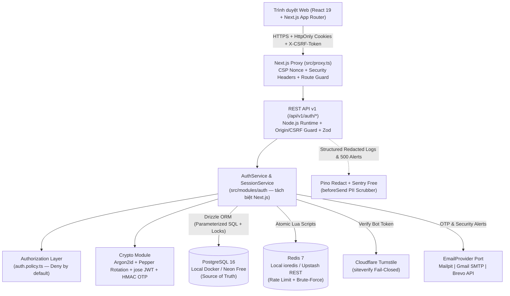
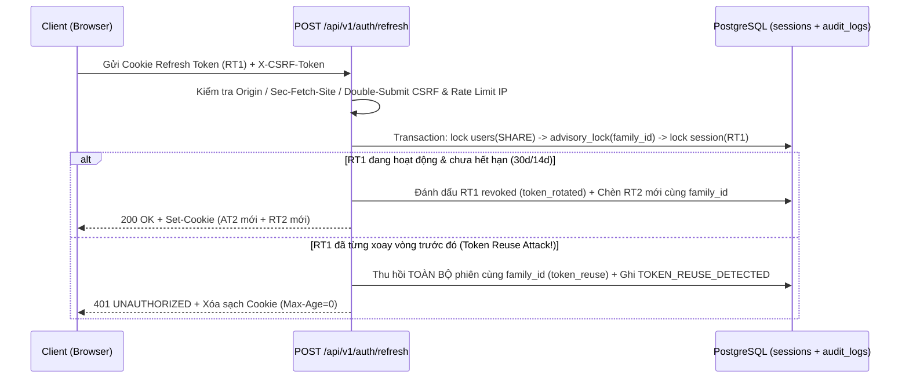

# TOMATO — Nền tảng Mạng Xã Hội (Giai đoạn 1: Tài khoản, Xác thực & Quản lý Phiên)

[](https://nextjs.org/)
[](https://www.typescriptlang.org/)
[](https://orm.drizzle.team/)
[](https://upstash.com/)
[](#4-bảng-quyết-định-công-nghệ-0đ-trọn-đời)

**TOMATO** là dự án mạng xã hội được thiết kế theo hướng **Web-First, Mobile-Ready** và **Security-First**.
Giai đoạn 1 tập trung xây dựng trọn vẹn phân hệ **Quản lý Danh tính, Xác thực & Quản lý Phiên (Identity, Authentication & Session Management)** đạt chuẩn bảo mật thực chiến (OWASP ASVS / NIST SP 800-63B), chạy live trên hạ tầng **0đ trọn đời** (không cần thẻ tín dụng, không dùng gói trial hay email `.edu`) nhưng sẵn sàng mở rộng lên quy mô lớn và ứng dụng di động (Flutter / React Native) ở Giai đoạn 2.

---

## Mục lục

1. [Tính năng Giai đoạn 1](#1-tính-năng-giai-đoạn-1)
2. [Kiến trúc Tổng thể (Modular Monolith)](#2-kiến-trúc-tổng-thể-modular-monolith)
3. [Cơ chế Xoay vòng Refresh Token & Reuse Detection](#3-cơ-chế-xoay-vòng-refresh-token--reuse-detection)
4. [Bảng Quyết định Công nghệ (0đ Trọn Đời)](#4-bảng-quyết-định-công-nghệ-0đ-trọn-đời)
5. [Danh sách Cơ chế Bảo mật đã Triển khai](#5-danh-sách-cơ-chế-bảo-mật-đã-triển-khai)
6. [Chạy Local trong 3 Bước](#6-chạy-local-trong-3-bước)
7. [Danh sách Biến Môi trường](#7-danh-sách-biến-môi-trường)
8. [Kiểm thử Tự động & CI/CD](#8-kiểm-thử-tự-động--cicd)
9. [Triển khai Production (0đ)](#9-triển-khai-production-0đ)
10. [Rủi ro Còn lại (Accepted Risks) & Định hướng Giai đoạn 2](#10-rủi-ro-còn-lại-accepted-risks--định-hướng-giai-đoạn-2)

---

## 1. Tính năng Giai đoạn 1

- **Đăng ký & Xác minh Email bằng OTP 6 số:** Kiểm tra tuổi tối thiểu 13+, chính sách cụm mật khẩu 12–128 ký tự (NFKC, chặn dấu tiếng Việt & mật khẩu yếu), chống bot bằng Cloudflare Turnstile, xử lý race condition đăng ký đồng thời (`23505`), OTP hiệu lực 15 phút (tối đa 5 lần nhập sai), gửi lại OTP có cooldown 60 giây.
- **Đăng nhập & Chống Brute-Force thông minh:**
  - Rate Limit IP (`10 lần / 15 phút`) chạy trước DB/Argon2id.
  - Theo dõi số lần sai theo cặp `(email + IP)` trên Redis: **Exponential Backoff (`1s → 2s → 4s → 8s`)** từ lần sai thứ 3 và **bắt buộc Cloudflare Turnstile (`requireCaptcha: true`)** từ lần sai thứ 5.
  - **Chống DoS tài khoản chủ:** Kẻ lạ tấn công từ IP khác (dưới mốc 50) không làm chậm hay ép CAPTCHA lên chủ tài khoản đang đăng nhập từ IP/thiết bị quen.
  - **Tự khóa bảo vệ ở mốc 50 lần sai liên tiếp:** Chuyển nguyên tử `active → locked`, ghi Audit Log `ACCOUNT_LOCKED` và gửi email cảnh báo kèm thời gian, IP, thiết bị và liên kết mở khóa qua _Quên mật khẩu_.
- **Quản lý Phiên & Thiết bị (`/settings/security`):** Liệt kê mọi thiết bị đang hoạt động, gắn nhãn thiết bị hiện tại, thu hồi từng thiết bị (chống IDOR trả `404`), đăng xuất toàn bộ thiết bị khác hoặc đăng xuất tất cả.
- **Quên mật khẩu & Đặt lại mật khẩu:** Token ngẫu nhiên 256-bit dùng một lần (hiệu lực 15 phút, lưu SHA-256), mở khóa tài khoản `locked → active`, thu hồi toàn bộ phiên cũ trên mọi thiết bị và gửi email cảnh báo bảo mật.
- **Đổi mật khẩu (khi đã đăng nhập):** Yêu cầu mật khẩu hiện tại + OTP xác nhận qua email (hiệu lực 10 phút), thu hồi mọi thiết bị khác và xoay vòng phiên hiện tại chống session fixation.

---

## 2. Kiến trúc Tổng thể (Modular Monolith)

Hệ thống tách biệt chặt chẽ **Tầng Giao tiếp HTTP (Next.js Route Handlers `/api/v1/auth/*`)**, **Tầng Nghiệp vụ Thuần túy (`src/modules/auth/`)** và **Lớp Cổng/Adapter (`src/core/`)** nhằm dễ dàng thay thế hạ tầng hoặc bổ sung Mobile Client mà không sửa nghiệp vụ lõi.



---

## 3. Cơ chế Xoay vòng Refresh Token & Reuse Detection

Mỗi phiên đăng nhập được cấp **Access Token JWT (15 phút)** và **Refresh Token opaque 256-bit (30 ngày tuyệt đối / 14 ngày không hoạt động, chỉ lưu SHA-256)** gắn theo `family_id`. Khi phát hiện Refresh Token cũ bị tái sử dụng (dấu hiệu bị đánh cắp), hệ thống khóa đồng bộ bằng `pg_advisory_xact_lock(family_id)` và thu hồi lập tức toàn bộ chuỗi phiên.



---

## 4. Bảng Quyết định Công nghệ (0đ Trọn Đời)

| Lớp                          | Công nghệ lựa chọn                                                               | Lý do chọn & Trade-off (Ngân sách 0đ)                                                                                                                                                     |
| :--------------------------- | :------------------------------------------------------------------------------- | :---------------------------------------------------------------------------------------------------------------------------------------------------------------------------------------- |
| **Framework & Hosting**      | Next.js 16 (App Router, TypeScript `strict`) trên **Vercel Hobby (`sin1`)**      | Triển khai HTTPS miễn phí tại Singapore (`sin1`), tự động CI preview. Khai báo `export const runtime = 'nodejs'` trên toàn bộ Auth routes để chạy native `@node-rs/argon2`.               |
| **Database & ORM**           | PostgreSQL 16 (**Neon Free**) + **Drizzle ORM**                                  | Hỗ trợ `SELECT ... FOR UPDATE`, `pg_advisory_xact_lock`, cột `INET`, `JSONB` và connection pooling miễn phí. Drizzle nhẹ, type-safe và không cần binary query engine nặng lúc cold-start. |
| **Cache & Anti-Abuse**       | Redis (**Upstash Free** HTTP REST / Local `ioredis`)                             | Upstash giao tiếp HTTP REST nên không bao giờ cạn kết nối TCP trên Serverless. Port chung `RedisClient` chạy cùng 1 tập Lua script nguyên tử ở cả local và prod.                          |
| **Mật mã học**               | `@node-rs/argon2`, `jose`, Node `crypto`                                         | Không tự chế thuật toán. Khai báo `serverExternalPackages: ['@node-rs/argon2']` để bundler giữ nguyên native Rust binary.                                                                 |
| **Email (Không cần domain)** | Local: **Mailpit** / Prod: **Gmail SMTP (App Password)** hoặc **Brevo REST API** | Gửi được tới mọi địa chỉ email người dùng thật với chi phí 0đ mà không cần mua tên miền riêng. Kiến trúc Port & Adapter sẵn sàng chuyển sang AWS SES / Resend khi có domain riêng.        |
| **Chống Bot**                | **Cloudflare Turnstile**                                                         | Miễn phí, thân thiện UX hơn reCAPTCHA, verify fail-closed phía server tại `siteverify`.                                                                                                   |
| **Giám sát & Log**           | **Pino** (`redact`) + **Sentry Free** (`beforeSend`)                             | Structured JSON log hiệu năng cao và cảnh báo lỗi 500 thực tế miễn phí (5.000 errors/tháng), lọc sạch PII/cookie/token trước khi rời máy chủ.                                             |

---

## 5. Danh sách Cơ chế Bảo mật đã Triển khai

1. **Lưu trữ mật khẩu chuẩn OWASP:** Chuẩn hóa Unicode `NFKC` (không `trim`), kết hợp khóa `HMAC-SHA256` Pepper tách khỏi DB (hỗ trợ đa phiên bản & tự động rehash khi nâng `CURRENT_PEPPER_VERSION`) và `Argon2id` (`m=19456`, `t=2`, `p=1`, `hashLength=32`).
2. **Chống Timing Attack & Account Enumeration tại `/login`:** Luôn chạy `verifyDummyPassword()` khi không tìm thấy email; đồng nhất mã lỗi `401 INVALID_CREDENTIALS`, thông báo và ngưỡng kích hoạt Backoff/Turnstile; chỉ kiểm tra trạng thái tài khoản sau khi đúng mật khẩu; kể cả khi vừa chạm mốc 50 lần sai vẫn trả `401` cho mật khẩu sai.
3. **Chống Brute-Force thông minh & Chống Slowloris/Account-DoS:** Kết hợp Rate Limit IP (Sliding Window Lua) + Stateless Redis Backoff Lock `(email + IP)` (`1s → 2s → 4s → 8s`) + Turnstile bắt buộc từ lần sai thứ 5 + khóa tài khoản nguyên tử ở mốc 50 lần sai liên tiếp trong PostgreSQL.
4. **Chống CSRF 3 lớp:** Cookie `SameSite=Lax` + kiểm tra `Origin` & `Sec-Fetch-Site` + Double-Submit Cookie (`X-CSRF-Token` đối chiếu `timingSafeEqual` với cookie `__Host-tomato_csrf`).
5. **Cookie bảo vệ tối đa:** `HttpOnly`, `SameSite=Lax`, `Path=/`, `Secure` và tự động bật tiền tố `__Host-` trên Production HTTPS (`__Host-tomato_at`, `__Host-tomato_rt`, `__Host-tomato_csrf`); không bao giờ lưu token trong `localStorage`/`sessionStorage`.
6. **Chống XSS & Clickjacking (Security Headers):** CSP nonce riêng biệt cho từng request (`'strict-dynamic'`, không `'unsafe-eval'` trên prod, `connect-src` chỉ mở đúng origin HTTPS của Turnstile và Sentry DSN nếu cấu hình), `X-Frame-Options: DENY`, `X-Content-Type-Options: nosniff`, `Permissions-Policy`, `HSTS` trên HTTPS, `Referrer-Policy: no-referrer` trên `/reset-password`, `Cache-Control: no-store, max-age=0` trên mọi API Auth.
7. **Chống IDOR / BOLA (Deny by Default):** Tập trung phân quyền tại `src/modules/auth/auth.policy.ts` + lọc kép `user_id` tại SQL; trả đồng nhất `404 Not Found` khi truy cập phiên của người khác.
8. **Không lộ khóa nội bộ (`UUIDv7`):** Mọi khóa chính dùng `UUIDv7` cho hiệu năng B-Tree Index, nhưng API/URL/JWT chỉ trả về `public_id` ngẫu nhiên (`UUIDv4`).
9. **Chống Race Condition & Deadlock:** Tuân thủ thứ tự khóa toàn cục `users → advisory_lock(family_id) → auth_identities/verification_tokens/sessions` trên toàn bộ transaction.
10. **Không rò rỉ dữ liệu nhạy cảm ra Log / Monitoring / Git:** Pino `redact` đa tầng, Sentry v11 `dataCollection` tắt thu thập cookie/header/body/query/PII ngay từ nguồn kết hợp `beforeSend`/`beforeBreadcrumb` lọc sạch dữ liệu nhạy cảm (tắt Session Replay), kiểm toán tự động không tồn tại `console.log` trong `src/`, CI chạy `gitleaks` và `npm audit`.

---

## 6. Chạy Local trong 3 Bước

**Yêu cầu:** Node.js `>= 24.0.0`, npm và Docker Desktop.

### Bước 1: Cài đặt phụ thuộc & tạo file môi trường cục bộ

```bash
npm install
cp .env.example .env.local
```

> Trên Windows PowerShell: `Copy-Item .env.example .env.local`. File `.env.example` đã cài sẵn cấu hình local cho Docker (Postgres cổng `5433`, Redis `6379`, Mailpit `1025`, Turnstile dummy keys).

### Bước 2: Khởi động PostgreSQL, Redis, Mailpit & chạy Migration

```bash
docker compose up -d
npm run db:migrate
```

### Bước 3: Khởi động ứng dụng & trải nghiệm

```bash
npm run dev
```

- Ứng dụng TOMATO: `http://localhost:3000`
- Kiểm tra sức khỏe hạ tầng: `http://localhost:3000/api/health`
- Hộp thư Mailpit (xem mã OTP & email cảnh báo cục bộ): `http://localhost:8025`

---

## 7. Danh sách Biến Môi trường

Mọi biến môi trường đều được kiểm tra **fail-fast bằng Zod** ngay lúc ứng dụng khởi động (`src/core/config/env.ts`). Sinh các bí mật 256-bit bằng:

```bash
node -e "console.log(require('crypto').randomBytes(32).toString('hex'))"
```

| Biến môi trường                                     | Bắt buộc             | Mô tả & Lưu ý bảo mật                                                                                    |
| :-------------------------------------------------- | :------------------- | :------------------------------------------------------------------------------------------------------- |
| `NODE_ENV`                                          | Có                   | `development` \| `test` \| `production`.                                                                 |
| `APP_URL`                                           | Có                   | URL gốc của ứng dụng. **Bắt buộc `https://` ở production**.                                              |
| `ALLOWED_ORIGINS`                                   | Tùy chọn             | Danh sách Origin cho phép gọi API thay đổi dữ liệu (phân cách bằng dấu phẩy; mặc định lấy từ `APP_URL`). |
| `LOG_LEVEL`                                         | Tùy chọn             | `fatal` \| `error` \| `warn` \| `info` \| `debug` \| `trace` \| `silent`.                                |
| `DATABASE_URL`                                      | Có                   | Chuỗi kết nối PostgreSQL (`postgresql://...`). Prod dùng Neon Pooled URL (`?sslmode=require`).           |
| `DB_POOL_MAX`                                       | Tùy chọn             | Số kết nối tối đa trong pool (mặc định `10`; khuyến nghị `5` trên Vercel Serverless).                    |
| `REDIS_PROVIDER`                                    | Có                   | `local` (Docker TCP) hoặc `upstash` (Production HTTP REST).                                              |
| `REDIS_URL`                                         | Khi `local`          | Chuỗi `redis://127.0.0.1:6379`.                                                                          |
| `UPSTASH_REDIS_REST_URL`                            | Khi `upstash`        | Endpoint `https://...upstash.io`.                                                                        |
| `UPSTASH_REDIS_REST_TOKEN`                          | Khi `upstash`        | REST token từ Upstash Console.                                                                           |
| `JWT_SECRET`                                        | Có (Secret)          | Khóa ký Access Token HS256 (`>= 32` ký tự), **phải khác** `OTP_SECRET` và Pepper.                        |
| `OTP_SECRET`                                        | Có (Secret)          | Khóa HMAC-SHA256 băm OTP 6 số (`>= 32` ký tự).                                                           |
| `CURRENT_PEPPER_VERSION`                            | Có                   | Số nguyên dương phiên bản Pepper hiện hành (ví dụ `1`).                                                  |
| `PASSWORD_PEPPER_SECRETS`                           | Có (Secret)          | JSON map `{"1":"<secret >= 32 ký tự>"}` hỗ trợ xoay vòng khóa không downtime.                            |
| `EMAIL_PROVIDER`                                    | Có                   | `mailpit` (chỉ dev/test — bị chặn trên prod) \| `gmail` \| `brevo` (hỗ trợ thêm alias `smtp`).           |
| `EMAIL_FROM`                                        | Có                   | Tên & địa chỉ người gửi, ví dụ `Tomato <yourname@gmail.com>`.                                            |
| `SMTP_HOST`, `SMTP_PORT`, `SMTP_SECURE`             | Khi `mailpit`/`smtp` | Mặc định `127.0.0.1:1025` cho `mailpit`, `smtp.gmail.com:465` (`secure=true`) cho `gmail`.               |
| `SMTP_USER`, `SMTP_PASS`                            | Khi `gmail`          | Địa chỉ Gmail và **App Password 16 ký tự** (tuyệt đối không dùng mật khẩu đăng nhập Gmail).              |
| `BREVO_API_KEY`                                     | Khi `brevo`          | API key v3 từ Brevo Dashboard.                                                                           |
| `NEXT_PUBLIC_TURNSTILE_SITE_KEY`                    | Có                   | Site key Cloudflare Turnstile (chặn dummy key ở `production`).                                           |
| `TURNSTILE_SECRET_KEY`                              | Có (Secret)          | Secret key Cloudflare Turnstile (chặn dummy key ở `production`).                                         |
| `SENTRY_DSN`, `NEXT_PUBLIC_SENTRY_DSN`              | Khuyến nghị Prod     | DSN dự án Next.js trên Sentry Free. Để trống ở local sẽ tự tắt Sentry.                                   |
| `SENTRY_ORG`, `SENTRY_PROJECT`, `SENTRY_AUTH_TOKEN` | Tùy chọn             | Chỉ dùng lúc `next build` trên Vercel nếu muốn tải source maps lên Sentry.                               |

---

## 8. Kiểm thử Tự động & CI/CD

```bash
npm run lint              # ESLint (Next Core Web Vitals + TypeScript strict)
npm run format:check      # Prettier
npm run typecheck         # TypeScript 6 strict (noEmit)
npm run test              # Unit Tests + Security Tests (không cần Docker)
npm run test:integration  # Integration Tests trên PostgreSQL + Redis thật
npm run build             # Kiểm tra đóng gói Production Next.js + Sentry
```

Pipeline GitHub Actions (`.github/workflows/ci.yml`) tự động chạy trên mọi Push/PR vào `main`:

- Dựng Service Containers `postgres:16-alpine`, `redis:7-alpine`, `axllent/mailpit`.
- Chạy `lint`, `format:check`, `typecheck`, `db:migrate`, toàn bộ Unit/Security/Integration Tests và `next build` production.
- Chạy job bảo mật độc lập: `npm audit --audit-level=high` và `gitleaks` quét toàn bộ lịch sử Git.

---

## 9. Triển khai Production (0đ)

Xem hướng dẫn checklist chi tiết từng cú click cho **Neon Free, Upstash Free, Cloudflare Turnstile, Gmail App Password / Brevo, Sentry Free, Vercel Hobby (`sin1`)**, chạy Drizzle Migration lên Neon DB và kịch bản Smoke Test HTTPS tại:

➡️ **[`docs/04-production-deployment-guide.md`](docs/04-production-deployment-guide.md)**

---

## 10. Rủi ro Còn lại (Accepted Risks) & Định hướng Giai đoạn 2

### Rủi ro còn lại ở Giai đoạn 1 (0đ)

1. **Giới hạn gửi email miễn phí & chưa có tên miền riêng (SPF/DKIM/DMARC riêng):** Gmail App Password giới hạn ~500 email/ngày (Brevo Free ~300 email/ngày) và có thể bị lọc vào tab Quảng cáo/Spam nếu lượng đăng ký tăng đột biến. _Giảm thiểu ở Giai đoạn 2:_ mua tên miền riêng, cấu hình SPF/DKIM/DMARC và chuyển Adapter sang AWS SES / Resend qua hàng đợi bất đồng bộ.
2. **Chưa kiểm tra mật khẩu từng rò rỉ (Have I Been Pwned) & chặn email rác (Disposable Email):** Hiện đã có danh sách mật khẩu phổ biến nội bộ, nhưng chưa gọi API HIBP k-anonymity để giữ thời gian phản hồi tối ưu và tránh phụ thuộc bên thứ 3 ở MVP.
3. **Cold-start Serverless & đơn vùng (Single Region):** Vercel Hobby + Neon Free có thể phát sinh cold-start (~300–800ms) sau thời gian dài không có truy cập; toàn bộ đặt tại Singapore (`sin1` / `ap-southeast-1`) để tối ưu người dùng Việt Nam/Đông Nam Á.
4. **Dọn dẹp định kỳ tài khoản `pending_verification` & bản ghi phiên hết hạn:** Hiện đã hỗ trợ đăng ký đè sạch tài khoản `pending_verification` quá 24 giờ, nhưng chưa có Cron dọn dẹp tự động bản ghi cũ để tránh giới hạn Cron của Vercel Hobby.
5. **Chưa có MFA/TOTP & Passkeys:** Người dùng chỉ xác thực 1 lớp mật khẩu (kèm OTP email cho thao tác nhạy cảm đổi mật khẩu).

### Định hướng Giai đoạn 2

- **Mở rộng Xác thực:** OAuth 2.0 / OIDC (Google, Apple, Facebook) tận dụng sẵn bảng `auth_identities`; Passkeys (WebAuthn) và MFA/TOTP dự phòng.
- **Mở rộng Bảo mật P1:** Kiểm tra mật khẩu rò rỉ qua HIBP k-anonymity, chặn disposable email domain, Risk Scoring theo địa lý/ASN bất thường, đa ngôn ngữ `i18n` (Tiếng Việt / Tiếng Anh) dựa trên từ điển `auth.messages.ts`.
- **Mobile App Ready (Flutter / React Native):** Bật chế độ trao đổi token qua `Authorization: Bearer` + JSON Body trên cùng `/api/v1/auth/*` mà không sửa `AuthService`/`SessionService`.
- **Tính năng Mạng xã hội cốt lõi:** Trang cá nhân công khai (`/@username`), Kết bạn/Theo dõi, Bảng tin (Newsfeed), Bài viết, Bình luận & Nhắn tin thời gian thực.
