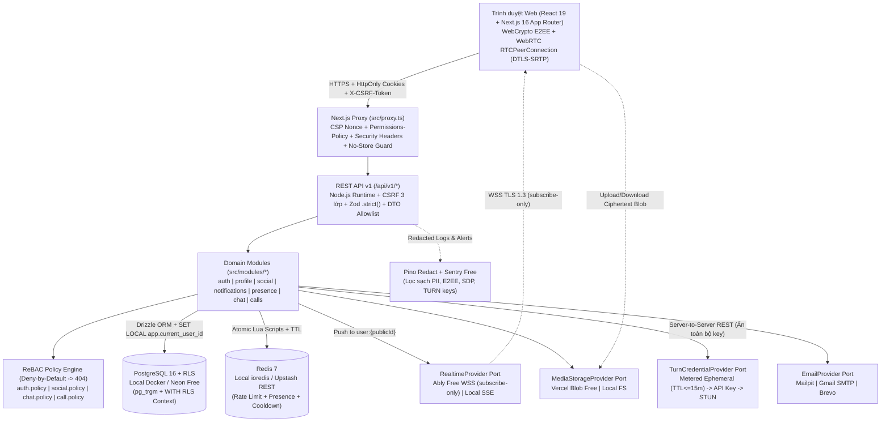
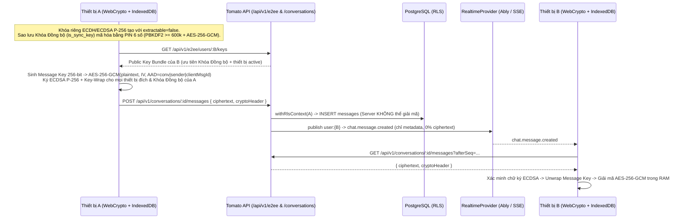
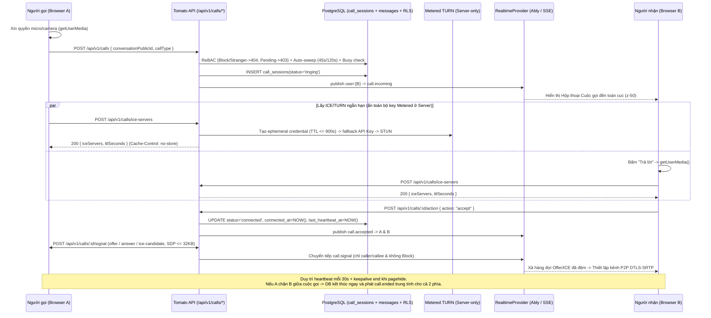

# TOMATO — Nền tảng Mạng Xã Hội Bảo mật (Giai đoạn 1 & 2: M0–M12)

[](https://nextjs.org/)
[](https://www.typescriptlang.org/)
[](https://orm.drizzle.team/)
[](https://upstash.com/)
[](#3-luồng-mã-hóa-đầu-cuối-e2ee--mã-pin-6-số-khóa-đồng-bộ)
[](#4-luồng-gọi-thoạivideo-1-1-webrtc-p2p--signaling-chống-bola)
[](#5-bảng-quyết-định-công-nghệ-0đ-trọn-đời)

**TOMATO** là nền tảng mạng xã hội được xây dựng theo kiến trúc **Modular Monolith**, ưu tiên tuyệt đối **Security-First (OWASP Top 10:2025, Deny-by-Default, Zero-Knowledge E2EE, PostgreSQL RLS, BOLA Defense-in-Depth)**, trải nghiệm sản phẩm thương mại sạch đẹp (0% thuật ngữ kỹ thuật trên giao diện) và vận hành thực tế **0đ trọn đời** (không thẻ tín dụng, không gói dùng thử giới hạn thời gian).

---

## Mục lục

1. [Tổng quan Tính năng (Giai đoạn 1 + 2: M0–M12)](#1-tổng-quan-tính-năng-giai-đoạn-1--2-m0m12)
2. [Kiến trúc Tổng thể (Modular Monolith — 0đ)](#2-kiến-trúc-tổng-thể-modular-monolith--0đ)
3. [Luồng Mã hóa Đầu cuối (E2EE) & Mã PIN 6 số Khóa Đồng bộ](#3-luồng-mã-hóa-đầu-cuối-e2ee--mã-pin-6-số-khóa-đồng-bộ)
4. [Luồng Gọi Thoại/Video 1-1 (WebRTC P2P & Signaling Chống BOLA)](#4-luồng-gọi-thoạivideo-1-1-webrtc-p2p--signaling-chống-bola)
5. [Bảng Quyết định Công nghệ (0đ Trọn Đời)](#5-bảng-quyết-định-công-nghệ-0đ-trọn-đời)
6. [Danh sách Cơ chế Bảo mật đã Triển khai](#6-danh-sách-cơ-chế-bảo-mật-đã-triển-khai)
7. [Chạy Local trong 3 Bước](#7-chạy-local-trong-3-bước)
8. [Danh sách Biến Môi trường (Bao gồm Ably, Vercel Blob & Metered TURN)](#8-danh-sách-biến-môi-trường-bao-gồm-ably-vercel-blob--metered-turn)
9. [Kiểm thử Tự động, Ma trận BOLA & CI/CD](#9-kiểm-thử-tự-động-ma-trận-bola--cicd)
10. [Triển khai Production (0đ Trọn Đời)](#10-triển-khai-production-0đ-trọn-đời)

---

## 1. Tổng quan Tính năng (Giai đoạn 1 + 2: M0–M12)

### Giai đoạn 1 (M0–M5): Danh tính, Xác thực & Quản lý Phiên

- **Đăng ký & Xác minh Email (OTP 6 số):** Kiểm tra tuổi 13+, cụm mật khẩu 12–128 ký tự (NFKC, **không cho phép dấu tiếng Việt**, chặn mật khẩu phổ biến), Cloudflare Turnstile fail-closed, Argon2id + Pepper Rotation đa phiên bản.
- **Đăng nhập & Chống Brute-Force thông minh:** Rate Limit IP, Exponential Backoff (`1s → 2s → 4s → 8s`) và bắt buộc Turnstile theo cặp `(email + IP)` chống DoS tài khoản chủ; tự khóa nguyên tử ở mốc 50 lần sai kèm email cảnh báo.
- **Xoay vòng Refresh Token & Phát hiện Tái sử dụng:** Access Token JWT 15 phút + Refresh Token opaque 256-bit theo `family_id`, khóa đồng bộ bằng `pg_advisory_xact_lock`, thu hồi toàn bộ chuỗi phiên ngay khi phát hiện token reuse.
- **Quản lý Thiết bị & Đổi/Đặt lại mật khẩu 2 bước (`/settings/security`):** Liệt kê thiết bị theo lịch sử, thu hồi từng thiết bị (trả `404` chống IDOR), đổi mật khẩu có OTP + ticket cookie HttpOnly.

### Giai đoạn 2 (M6–M12): Kết nối Xã hội, Nhắn tin E2EE & Gọi Thoại/Video 1-1

- **Hồ sơ `@user_id`, Tìm kiếm & Ảnh đại diện (M6):** Chuẩn hóa NFKC + lowercase, chặn từ khóa dành riêng, giữ chỗ handle cũ 14 ngày; tìm kiếm siêu tốc bằng `pg_trgm` + `varchar_pattern_ops` (không tìm theo email); cắt ảnh đại diện (`react-easy-crop`) + pipeline `sharp` (kiểm magic bytes, cấm SVG, giới hạn pixel, xóa EXIF/GPS, nén WebP 512×512).
- **Mạng lưới Follow, Tài khoản Riêng tư & Chặn 2 chiều (M7):** Máy trạng thái `none → requested → following` trong 1 transaction đồng bộ bộ đếm; duyệt/từ chối yêu cầu follow, gỡ follower; chặn hai chiều ẩn hoàn toàn trên Search/Profile/Lists/Chat/Calls và trả đồng nhất `404 Not Found` (im lặng tuyệt đối).
- **Thông báo Realtime & Trạng thái Hoạt động Đối xứng (M8):** Hạ tầng Realtime `subscribe-only` trên kênh cá nhân `user:{publicId}` (Ably Free ở Production / SSE cục bộ ở Local & CI); Presence lưu Redis TTL 90s kèm làm tròn mốc thời gian thô và cưỡng chế đối xứng 100% ở Server.
- **Nhắn tin 1-1 Zero-Knowledge E2EE, Mã PIN 6 số & Tin nhắn đang chờ (M9–M10):**
  - Mã hóa đầu cuối chuẩn Web Crypto API (`ECDH P-256` + `ECDSA P-256` + `HKDF-SHA256` + `AES-256-GCM` + `AAD`), khóa riêng `extractable: false` trong IndexedDB, Mã an toàn (Safety Number), và **Mã PIN 6 số dùng Khóa Đồng bộ (`is_sync_key`)** (`PBKDF2-SHA256 >= 600.000` vòng + `AES-256-GCM`) giúp khôi phục lịch sử trên thiết bị mới mà Server không giải mã được.
  - Tin nhắn đang chờ (`pending`): Server cưỡng chế chỉ văn bản, tối đa 3 tin, tối đa 5 người lạ mới/ngày, không lộ Đã xem/Hoạt động.
  - Sửa tin nhắn văn bản (tối đa 5 lần) và Thu hồi mọi loại tin nhắn trong **5 phút đầu theo đồng hồ PostgreSQL**; Xóa 1 dòng tin nhắn phía mình (`message_user_deletions`); Xóa đoạn chat phía mình (`cleared_before_seq`); Trạng thái Đã xem đối xứng.
  - Giao diện tối giản với `AppLeftSidebar`, `AppTopBar` và `FloatingMessagesWidget` đồng bộ qua RAM cache.
- **Ảnh HD & Tin nhắn thoại E2EE (M11):** Mã hóa tệp `AES-256-GCM` + kiểm tra toàn vẹn `SHA-256` phía Client; tải thẳng lên Vercel Blob bằng client upload token (tránh trần body 4.5MB của Vercel Hobby) và kiểm tra quyền thành viên hội thoại khi tải về; thu hồi tin nhắn tự xóa tệp bản mã trên Storage.
- **Gọi Thoại & Gọi Video 1-1 WebRTC (M12):**
  - Cuộc gọi P2P mã hóa bắt buộc **DTLS-SRTP**, signaling qua REST API + `RealtimeProvider` (chỉ gọi được trong hội thoại `primary`, chặn Block 2 chiều trả `404`, rate limit 5 cuộc/phút + cooldown chống gọi dồn sau khi bị từ chối).
  - Cấp phát **TURN credential ngắn hạn (TTL ≤ 15 phút)** từ Metered phía Server (3 tầng fallback êm sang STUN công khai), cơ chế heartbeat 30s + `pagehide` `keepalive` + auto-sweep chống kẹt `CALL_BUSY`, ngắt cuộc gọi tức thì khi Block giữa cuộc gọi, tự timeout `missed` sau 45 giây, nâng cấp gọi thoại → video giữa cuộc gọi, và tự động ghi thẻ lịch sử `call_event` nhất quán trên mọi thiết bị kể cả chưa nhập Mã PIN.

---

## 2. Kiến trúc Tổng thể (Modular Monolith — 0đ)



---

## 3. Luồng Mã hóa Đầu cuối (E2EE) & Mã PIN 6 số Khóa Đồng bộ



---

## 4. Luồng Gọi Thoại/Video 1-1 (WebRTC P2P & Signaling Chống BOLA)



---

## 5. Bảng Quyết định Công nghệ (0đ Trọn Đời)

| Lớp                        | Công nghệ lựa chọn                                                                                                                 | Lý do chọn & Trade-off (0đ trọn đời)                                                                                                                                          |
| :------------------------- | :--------------------------------------------------------------------------------------------------------------------------------- | :---------------------------------------------------------------------------------------------------------------------------------------------------------------------------- |
| **Framework & Hosting**    | Next.js 16 (App Router, TypeScript 6 `strict`) trên **Vercel Hobby (`sin1`)**                                                      | HTTPS miễn phí tại Singapore, CI preview tự động. Toàn bộ API dùng `runtime = 'nodejs'` để hỗ trợ native `@node-rs/argon2` và `sharp`.                                        |
| **Database & ORM**         | PostgreSQL 16 (**Neon Free**) + **Drizzle ORM** + **RLS**                                                                          | ACID Transaction, `pg_trgm`, `FOR UPDATE`, `pg_advisory_xact_lock`, và Row-Level Security làm lớp phòng thủ thứ hai độc lập với mã ứng dụng.                                  |
| **Cache & Anti-Abuse**     | Redis (**Upstash Free** REST / Local `ioredis`)                                                                                    | HTTP REST không tốn kết nối TCP trên Serverless; chạy chung tập Lua script Rate Limit nguyên tử, Presence TTL và Call Cooldown.                                               |
| **Realtime WSS**           | **Ably Free Tier** (6M tin/tháng, 200 kết nối) qua `RealtimeProvider`                                                              | Server cấp Token Request 15 phút chỉ có quyền `subscribe` trên `user:{publicId}`. Local/CI dùng `InMemoryRealtimeAdapter` + SSE hoàn toàn offline.                            |
| **Media & Avatar**         | **Vercel Blob Hobby Free** + `sharp` + `LocalFsStorageAdapter`                                                                     | Avatar re-encode WebP xóa sạch EXIF; Ảnh HD/Voice chat mã hóa `AES-256-GCM` phía Client trước khi upload bằng client upload token.                                            |
| **E2EE & WebRTC**          | **Web Crypto API** (`ECDH/ECDSA P-256` + `AES-256-GCM`) & **RTCPeerConnection** (`DTLS-SRTP`) + **Metered TURN Free** (20GB/tháng) | Chuẩn mật mã gốc của trình duyệt, khóa `extractable: false` trong IndexedDB; Server cấp ephemeral TURN credential ngắn hạn $\le 15$ phút, fallback STUN công khai khi dev/CI. |
| **Email & Bot & Giám sát** | Gmail SMTP / Brevo Free, Cloudflare Turnstile, Pino Redact + Sentry Free                                                           | Gửi email thật không cần domain riêng; lọc sạch PII, token, E2EE, SDP và khóa TURN trước khi log/gửi cảnh báo.                                                                |

---

## 6. Danh sách Cơ chế Bảo mật đã Triển khai

1. **Chống BOLA / IDOR 2 lớp (OWASP API1):** Policy ReBAC tập trung (`auth`, `social`, `chat`, `call`) trả `404 Not Found` đồng nhất + **PostgreSQL Row-Level Security (RLS)** kích hoạt trên `user_e2ee_devices`, `user_e2ee_key_backups`, `conversations`, `conversation_participants`, `messages`, `message_user_deletions`, `message_attachments`, `call_sessions` (đã kiểm chứng bằng role `NOBYPASSRLS`).
2. **Không lộ khóa nội bộ (`UUIDv7`):** Mọi khóa chính là UUIDv7; toàn bộ API/URL/JWT/Realtime chỉ chấp nhận và trả về `public_id` (UUIDv4) hoặc `@handle`.
3. **Zero-Knowledge E2EE & Mã PIN 6 số:** Server không bao giờ nhìn thấy plaintext tin nhắn, khóa riêng, mã PIN hay `fileKey`/`fileIv`.
4. **Cưỡng chế luật nghiệp vụ 100% ở Server:** Giới hạn 5 phút sửa/thu hồi theo đồng hồ PostgreSQL `NOW()`, giới hạn 3 tin nhắn chờ & 5 người lạ/ngày, đối xứng Active Status & Read Receipts, cấm gọi trong `pending`, ngắt cuộc gọi tức thì khi Block, timeout 45s và auto-sweep heartbeat 2 phút chống kẹt `CALL_BUSY`.
5. **Chống CSRF 3 lớp & Cookie `__Host-`:** `SameSite=Lax` + `Origin`/`Sec-Fetch-Site` + Double-Submit `X-CSRF-Token` (`timingSafeEqual`).
6. **CSP Nonce & Security Headers:** Không `'unsafe-eval'` trên Production, `Permissions-Policy: camera=(self), microphone=(self), geolocation=()`, `X-Frame-Options: DENY`, `HSTS` trên HTTPS, `Cache-Control: no-store, max-age=0` trên toàn bộ API nhạy cảm.
7. **Redaction Đa tầng & Chống rò rỉ bí mật:** Pino `redact`, Sentry `beforeSend`/`beforeBreadcrumb`, Audit Log sanitizer lọc sạch mật khẩu, JWT, cookie, khóa E2EE, SDP, ICE candidate, `METERED_SECRET_KEY`, `METERED_TURN_API_KEY`; CI quét toàn lịch sử Git bằng `gitleaks` và ghim toàn bộ GitHub Actions theo commit SHA 40 ký tự.

---

## 7. Chạy Local trong 3 Bước

**Yêu cầu:** Node.js `>= 24.0.0`, npm và Docker Desktop.

```bash
# Bước 1: Cài đặt phụ thuộc & tạo file môi trường cục bộ
npm install
cp .env.example .env.local   # PowerShell: Copy-Item .env.example .env.local

# Bước 2: Khởi động PostgreSQL, Redis, Mailpit & chạy toàn bộ migration (0000 -> 0010)
docker compose up -d
npm run db:migrate

# Bước 3: Khởi động ứng dụng (chạy mượt 100% offline không cần Ably/Blob/Metered key)
npm run dev
```

- Ứng dụng TOMATO: `http://localhost:3000`
- Kiểm tra sức khỏe hạ tầng: `http://localhost:3000/api/health`
- Hộp thư Mailpit cục bộ: `http://localhost:8025`

---

## 8. Danh sách Biến Môi trường (Bao gồm Ably, Vercel Blob & Metered TURN)

Mọi biến môi trường được kiểm tra **fail-fast bằng Zod** tại `src/core/config/env.ts`. Sinh bí mật 256-bit:

```bash
node -e "console.log(require('crypto').randomBytes(32).toString('hex'))"
```

| Biến môi trường                                                                             | Bắt buộc             | Mô tả & Lưu ý bảo mật                                                                                                                                                       |
| :------------------------------------------------------------------------------------------ | :------------------- | :-------------------------------------------------------------------------------------------------------------------------------------------------------------------------- |
| `NODE_ENV`, `APP_URL`, `ALLOWED_ORIGINS`, `LOG_LEVEL`                                       | `APP_URL` bắt buộc   | Production bắt buộc `APP_URL=https://...` cho cookie `__Host-` và HSTS.                                                                                                     |
| `DATABASE_URL`, `DB_POOL_MAX`                                                               | `DATABASE_URL`       | PostgreSQL 16 (Prod dùng Neon Pooled `?sslmode=require`, `DB_POOL_MAX=5`).                                                                                                  |
| `REDIS_PROVIDER`, `REDIS_URL` / `UPSTASH_REDIS_REST_URL` & `UPSTASH_REDIS_REST_TOKEN`       | Có                   | `local` (Docker TCP) hoặc `upstash` (Production HTTP REST).                                                                                                                 |
| `JWT_SECRET`, `OTP_SECRET`, `CURRENT_PEPPER_VERSION`, `PASSWORD_PEPPER_SECRETS`             | Có (Secret)          | Độc lập, mỗi secret $\ge 32$ ký tự (256-bit), tuyệt đối không dùng chung.                                                                                                   |
| `EMAIL_PROVIDER`, `EMAIL_FROM`, `SMTP_*` / `BREVO_API_KEY`                                  | Có                   | `mailpit` (chỉ dev/test) \| `gmail` (App Password 16 ký tự) \| `brevo`.                                                                                                     |
| `NEXT_PUBLIC_TURNSTILE_SITE_KEY`, `TURNSTILE_SECRET_KEY`                                    | Có                   | Cloudflare Turnstile (tự động chặn dummy key trên Production).                                                                                                              |
| `STORAGE_PROVIDER`, `LOCAL_STORAGE_DIR`, `BLOB_READ_WRITE_TOKEN`                            | Prod dùng Blob       | Tự chọn `vercel_blob` khi có `BLOB_READ_WRITE_TOKEN`, mặc định `local` khi dev/CI.                                                                                          |
| `REALTIME_PROVIDER`, `ABLY_API_KEY`                                                         | Prod dùng Ably       | **Server-only** (không dùng `NEXT_PUBLIC_`). Tự chọn `local` SSE khi dev/test.                                                                                              |
| `METERED_DOMAIN`                                                                            | Tùy chọn (Prod)      | **Server-only** — hostname workspace Metered (ví dụ `tomato-social.metered.live`, không kèm `https://`).                                                                    |
| `METERED_SECRET_KEY`                                                                        | Tùy chọn (Ưu tiên 1) | **Server-only** — khóa bí mật cấp workspace để Server tạo ephemeral TURN credential ngắn hạn (TTL $\le 15$ phút).                                                           |
| `METERED_TURN_API_KEY`                                                                      | Tùy chọn (Ưu tiên 2) | **Server-only** — khóa TURN API dự phòng khi không cấu hình `METERED_SECRET_KEY` hoặc tạo ephemeral thất bại. Khi bỏ trống cả 3 biến, tự fallback sạch sang STUN công khai. |
| `SENTRY_DSN`, `NEXT_PUBLIC_SENTRY_DSN`, `SENTRY_ORG`, `SENTRY_PROJECT`, `SENTRY_AUTH_TOKEN` | Khuyến nghị Prod     | Tự tắt nếu để trống ở local.                                                                                                                                                |

---

## 9. Kiểm thử Tự động, Ma trận BOLA & CI/CD

```bash
npm run db:migrate        # Chạy toàn bộ Drizzle migrations (0000 -> 0010)
npm run lint              # ESLint (Next Core Web Vitals + TypeScript strict)
npm run format:check      # Prettier
npm run typecheck         # TypeScript 6 strict (noEmit)
npm run test              # Unit Tests + Security Tests + Ma trận BOLA 5 nhân vật (không cần Docker)
npm run test:integration  # Integration + PostgreSQL RLS (NOBYPASSRLS) Tests trên Postgres + Redis thật
npm run build             # Kiểm tra đóng gói Production Next.js (không cần .env.local)
```

- **Ma trận BOLA Tổng hợp (`tests/security/phase2-bola-matrix.test.ts`):** Kiểm thử chéo 5 nhân vật `{User A, User B, User C bị chặn, User D người lạ/ngoài cuộc, Anon}` trên toàn bộ 11 nhóm tính năng Giai đoạn 2 (Profile, Search, Follow/Requests, Block, Notifications, Realtime Token, Presence, Conversations/Pending, Messages, Encrypted Media, Calls).
- **Pipeline GitHub Actions (`.github/workflows/ci.yml`):** Ghim 100% action theo **commit SHA 40 ký tự**, dùng `npm ci`, dựng service container `postgres:16-alpine` + `redis:7-alpine` + `mailpit`, chạy toàn bộ lint/typecheck/tests/migrate/build, cùng job bảo mật độc lập `npm audit --audit-level=high` và `gitleaks`.

---

## 10. Triển khai Production (0đ Trọn Đời)

1. **Neon PostgreSQL Free (Singapore):** Tạo database, bật pooled connection (`DATABASE_URL`), chạy `npm run db:migrate`.
2. **Upstash Redis Free (Singapore):** Tạo Redis database, điền `REDIS_PROVIDER=upstash`, `UPSTASH_REDIS_REST_URL`, `UPSTASH_REDIS_REST_TOKEN`.
3. **Ably Free Tier:** Tạo App mới, lấy Root/Publish+Subscribe API key gán vào biến Server `ABLY_API_KEY` (tuyệt đối không có `NEXT_PUBLIC_`).
4. **Vercel Blob Hobby Free:** Gắn Blob Store vào dự án Vercel để tự động bơm `BLOB_READ_WRITE_TOKEN`.
5. **Metered TURN Free (20GB/tháng, không cần thẻ):**
   - Đăng ký tài khoản tại [metered.ca](https://www.metered.ca), tạo App lấy domain `<app>.metered.live`.
   - Cấu hình đúng 3 biến môi trường phía Server trên Vercel Project Settings:
     - `METERED_DOMAIN=<app>.metered.live`
     - `METERED_SECRET_KEY=<workspace-secret-key>`
     - `METERED_TURN_API_KEY=<turn-credential-api-key>`
6. **Cloudflare Turnstile + Email (Gmail App Password / Brevo) + Sentry Free:** Xem thêm hướng dẫn chi tiết từng bước tại [`docs/04-production-deployment-guide.md`](docs/04-production-deployment-guide.md).
