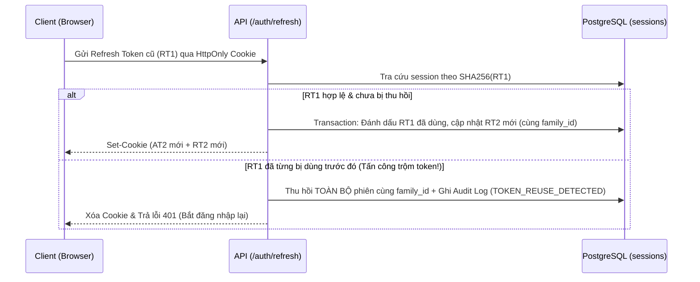

# ĐẶC TẢ KỸ THUẬT — PHẦN 2: CƠ SỞ DỮ LIỆU, API, BẢO MẬT & LỘ TRÌNH (MỤC 4–9)

- **Dự án:** TOMATO — Mạng xã hội
- **Giai đoạn:** 1 — Hệ thống Xác thực & Quản lý Phiên
- **Phiên bản:** 1.0
- **Tài liệu liên quan:** Phần 1 xem tại `docs/02-technical-spec-architecture.md` (Mục 1 đến Mục 3).

---

## 4. Thiết kế Cơ sở dữ liệu (PostgreSQL Schema)

**Quy ước ID (Quan trọng cho bảo mật & mở rộng):**
- **Khóa chính nội bộ (`id`):** `UUIDv7` (sinh ở tầng ứng dụng bằng thư viện `uuidv7`). Vì UUIDv7 tăng dần theo thời gian, nó giữ hiệu năng ghi B-Tree Index tối ưu khi bảng đạt hàng chục triệu dòng. **Không bao giờ lộ `id` nội bộ ra URL hoặc API công khai.**
- **ID công khai (`public_id`):** `UUIDv4` (hoặc chuỗi ngẫu nhiên URL-safe 21 ký tự bằng `crypto`), dùng để trả về trong API/URL nhằm tránh lộ số lượng người dùng và tốc độ tăng trưởng.

### 4.1. Bảng `users`
Lưu thông tin cốt lõi của người dùng, tách biệt khỏi phương thức đăng nhập.
- `id`: `UUID` (PK, UUIDv7)
- `public_id`: `VARCHAR(36)` (UNIQUE, NOT NULL)
- `display_name`: `VARCHAR(50)` (NOT NULL)
- `date_of_birth`: `DATE` (NOT NULL)
- `status`: `ENUM('pending_verification', 'active', 'locked', 'suspended', 'deleted')` (NOT NULL, DEFAULT `'pending_verification'`)
- `created_at`: `TIMESTAMPTZ` (NOT NULL, DEFAULT NOW())
- `updated_at`: `TIMESTAMPTZ` (NOT NULL, DEFAULT NOW())
- `deleted_at`: `TIMESTAMPTZ` (NULL)

### 4.2. Bảng `auth_identities`
Tách riêng để sau này thêm OAuth (Google/Apple), Passkeys hoặc Số điện thoại mà không sửa bảng `users`.
- `id`: `UUID` (PK, UUIDv7)
- `user_id`: `UUID` (FK tham chiếu `users.id` ON DELETE CASCADE, NOT NULL)
- `provider`: `ENUM('email_password')` (NOT NULL)
- `identifier_normalized`: `VARCHAR(255)` (NOT NULL) — Email đã qua `trim().normalize('NFKC').toLowerCase()`.
- `password_hash`: `TEXT` (NULL — dùng cho provider `email_password`, lưu định dạng PHC string)
- `pepper_version`: `SMALLINT` (NOT NULL, DEFAULT 1)
- `verified_at`: `TIMESTAMPTZ` (NULL)
- `failed_login_attempts`: `INTEGER` (NOT NULL, DEFAULT 0)
- `created_at`, `updated_at`: `TIMESTAMPTZ`
- **Indexes:** `UNIQUE INDEX idx_identities_provider_identifier (provider, identifier_normalized)`, `INDEX idx_identities_user_id (user_id)`.

### 4.3. Bảng `sessions`
Mỗi thiết bị đăng nhập tương ứng một bản ghi phiên.
- `id`: `UUID` (PK, UUIDv7)
- `public_id`: `VARCHAR(36)` (UNIQUE, NOT NULL — dùng cho API thu hồi phiên)
- `user_id`: `UUID` (FK tham chiếu `users.id` ON DELETE CASCADE, NOT NULL)
- `family_id`: `UUID` (NOT NULL — gom nhóm chuỗi xoay vòng Refresh Token)
- `refresh_token_hash`: `CHAR(64)` (UNIQUE, NOT NULL — SHA-256 hex của Refresh Token hiện tại)
- `device_info`: `VARCHAR(255)` (Parsed từ User-Agent, ví dụ "Chrome 130 / Windows 11")
- `ip_address`: `INET` (NOT NULL)
- `last_used_at`: `TIMESTAMPTZ` (NOT NULL)
- `expires_at`: `TIMESTAMPTZ` (NOT NULL — hạn tuyệt đối, ví dụ 30 ngày)
- `revoked_at`: `TIMESTAMPTZ` (NULL)
- `revoke_reason`: `VARCHAR(50)` (NULL — ví dụ `'user_logout'`, `'token_reuse'`, `'password_reset'`)
- `created_at`: `TIMESTAMPTZ` (NOT NULL)
- **Indexes:** `INDEX idx_sessions_user_active (user_id, revoked_at)`, `INDEX idx_sessions_family_id (family_id)`.

### 4.4. Bảng `verification_tokens`
Lưu mã OTP xác minh email, token đặt lại mật khẩu và OTP đổi mật khẩu.
- `id`: `UUID` (PK, UUIDv7)
- `user_id`: `UUID` (FK tham chiếu `users.id` ON DELETE CASCADE, NOT NULL)
- `purpose`: `ENUM('email_verify', 'password_reset', 'password_change')` (NOT NULL)
- `token_hash`: `CHAR(64)` (NOT NULL — SHA-256 cho token dài tối thiểu 256-bit; hoặc HMAC-SHA256 dùng `OTP_SECRET` của server cho mã OTP 6 số)
- `attempt_count`: `SMALLINT` (NOT NULL, DEFAULT 0)
- `expires_at`: `TIMESTAMPTZ` (NOT NULL)
- `consumed_at`: `TIMESTAMPTZ` (NULL)
- `created_at`: `TIMESTAMPTZ` (NOT NULL)
- **Indexes:** `INDEX idx_vtokens_user_purpose (user_id, purpose, consumed_at)`, `INDEX idx_vtokens_hash (token_hash)`.

### 4.5. Bảng `audit_logs`
Nhật ký bảo mật phục vụ điều tra sự cố. **Tuyệt đối không lưu mật khẩu, token, OTP.**
- `id`: `UUID` (PK, UUIDv7)
- `user_id`: `UUID` (NULL — vì sự kiện thất bại có thể không gắn với user nào)
- `action`: `VARCHAR(64)` (NOT NULL — `REGISTER`, `EMAIL_VERIFIED`, `LOGIN_SUCCESS`, `LOGIN_FAILED`, `ACCOUNT_LOCKED`, `SESSION_REVOKED`, `TOKEN_REUSE_DETECTED`, `PASSWORD_RESET`, `PASSWORD_CHANGED`)
- `ip_address`: `INET` (NULL)
- `user_agent`: `TEXT` (NULL)
- `metadata`: `JSONB` (DEFAULT `'{}'`)
- `created_at`: `TIMESTAMPTZ` (NOT NULL)
- **Indexes:** `INDEX idx_audit_user_created (user_id, created_at DESC)`.

---

## 5. Đặc tả API Contract (REST v1)

Mọi endpoint dưới đây đều nằm dưới tiền tố `/api/v1/auth` và trả header `Cache-Control: no-store, max-age=0`.

| Method | Endpoint | Mô tả | Yêu cầu xác thực |
| :--- | :--- | :--- | :--- |
| `POST` | `/register` | Đăng ký tài khoản mới + gửi OTP | Public + Turnstile |
| `POST` | `/verify-email` | Xác minh email bằng OTP 6 số | Public |
| `POST` | `/resend-verification` | Gửi lại mã OTP (cooldown 60s) | Public |
| `POST` | `/login` | Đăng nhập, cấp cặp Access/Refresh cookie | Public (+ Turnstile khi cần) |
| `POST` | `/refresh` | Xoay vòng Refresh Token, cấp Access Token mới | Refresh Cookie |
| `POST` | `/logout` | Đăng xuất thiết bị hiện tại | Access/Refresh Cookie |
| `POST` | `/forgot-password` | Yêu cầu link đặt lại mật khẩu | Public (+ Turnstile khi cần) |
| `POST` | `/reset-password` | Đặt lại mật khẩu bằng token một lần | Public |
| `POST` | `/change-password/request-otp` | Gửi OTP xác nhận đổi mật khẩu | Access Token |
| `POST` | `/change-password` | Đổi mật khẩu (cần pass cũ + OTP) | Access Token |
| `GET` | `/me` | Lấy thông tin người dùng hiện tại (`public_id`, `displayName`, `status`) | Access Token |
| `GET` | `/sessions` | Lấy danh sách thiết bị đang hoạt động | Access Token |
| `DELETE` | `/sessions/:sessionPublicId` | Thu hồi 1 phiên cụ thể | Access Token |
| `POST` | `/sessions/revoke-all` | Đăng xuất tất cả thiết bị khác (hoặc tất cả) | Access Token |

---

## 6. Đặc tả Bảo mật & Chống tấn công mạng

### 6.1. Lưu trữ & Xác minh Mật khẩu
1. **Chuẩn hóa:** Áp dụng `password.normalize('NFKC')` trước khi xử lý. Không `trim()` mật khẩu (khoảng trắng là ký tự hợp lệ).
2. **Pepper:** Tính `peppered = HMAC-SHA256(PEPPER_SECRET[version], normalizedPassword)`. Khóa Pepper lưu tại Encrypted Environment Variables (tách hoàn toàn khỏi DB). Lưu kèm `pepper_version` cạnh hash để hỗ trợ xoay khóa (key rotation): khi user đăng nhập thành công mà `pepper_version` cũ hơn `CURRENT_PEPPER_VERSION` hoặc tham số Argon2 cũ hơn, tự động băm lại (rehash) và cập nhật DB.
3. **Băm bằng Argon2id:**
   - Tham số chuẩn OWASP: `memoryCost = 19456` (19 MiB), `timeCost = 2`, `parallelism = 1`, `hashLength = 32`, salt ngẫu nhiên 16 bytes riêng cho từng mật khẩu.
   - Lưu chuỗi chuẩn PHC để tự nhận diện tham số cũ khi nâng cấp.
4. **Chống lộ thông tin qua thời gian (Timing Attack / User Enumeration):** Khi đăng nhập với email không tồn tại, hệ thống vẫn thực hiện một lượt `argon2.verify()` với một chuỗi hash giả (dummy hash) tạo sẵn để thời gian phản hồi đồng nhất (~150–400ms).

### 6.2. Kiến trúc Phiên & Cơ chế Xoay vòng Refresh Token (Reuse Detection)
- **Access Token:** JWT ký bằng thuật toán `EdDSA` hoặc `HS256` (dùng thư viện `jose`), thời hạn ngắn **15 phút**, payload tối giản (`sub`: `user.public_id`, `sid`: `session.public_id`, `iat`, `exp`).
- **Refresh Token:** Chuỗi ngẫu nhiên mật mã học tối thiểu **256 bit** (`crypto.randomBytes(32).toString('base64url')`), không mang nội dung (opaque), chỉ lưu bản băm `SHA-256` trong bảng `sessions`. Thời hạn tuyệt đối **30 ngày**, thời hạn không hoạt động **14 ngày**.
- **Lưu trữ Cookie (Web):**
  - Thuộc tính bắt buộc: `HttpOnly`, `SameSite=Lax`, `Path=/`, `Secure` (bật trên HTTPS/Production).
  - Tên cookie trên Production dùng prefix `__Host-` (`__Host-tomato_at`, `__Host-tomato_rt`) để ngăn subdomain ghi đè cookie. Trên môi trường Local HTTP (`NODE_ENV=development`), tự động bỏ prefix `__Host-` để trình duyệt không từ chối cookie.
  - Tuyệt đối không lưu token vào `localStorage` hay `sessionStorage`.

### 6.3. Chống CSRF, XSS & Security Headers
- **Chống CSRF:** Kết hợp 3 lớp:
  1. Cookie `SameSite=Lax`.
  2. Middleware kiểm tra chặt header `Origin` và `Sec-Fetch-Site` khớp với danh sách origin cho phép của Tomato cho mọi request thay đổi dữ liệu (`POST`, `PUT`, `PATCH`, `DELETE`).
  3. Cơ chế Double-Submit CSRF Token (`X-CSRF-Token` header đối chiếu với cookie không-HttpOnly `__Host-tomato_csrf` sinh ngẫu nhiên mỗi phiên) cho các API nhạy cảm.
- **Security Headers (cấu hình trong `middleware.ts` / `next.config.ts`):**
  - `Content-Security-Policy`: Hạn chế script nguồn lạ, không dùng `unsafe-eval`, dùng nonce hoặc hash chặt chẽ ở production.
  - `Strict-Transport-Security`: `max-age=31536000; includeSubDomains` (chỉ bật trên HTTPS).
  - `X-Content-Type-Options: nosniff`
  - `X-Frame-Options: DENY` (kèm CSP `frame-ancestors 'none'`)
  - `Referrer-Policy: strict-origin-when-cross-origin`
  - `Permissions-Policy`: Tắt camera, microphone, geolocation không cần thiết.

### 6.4. Chống Brute-Force & Lạm dụng (Rate Limiting trên Upstash Redis)
Rate limit luôn chạy **TRƯỚC** khi truy vấn DB nặng hoặc băm Argon2id:
- `/register`: 5 lần / 15 phút theo IP.
- `/login`: 10 lần / 15 phút theo IP; kết hợp bộ đếm riêng theo `(email + IP)` cho Exponential Backoff (trễ 1s, 2s, 4s, 8s) và yêu cầu Turnstile sau 5 lần sai; bộ đếm tổng trên `email` (50 lần sai liên tiếp sẽ khóa tạm `locked`).
- `/forgot-password` & `/resend-verification`: 3 lần / 15 phút theo `(IP)` và `(email)`.
- `/verify-email`: 5 lần thử sai / mỗi mã OTP.

### 6.5. Chống IDOR / BOLA (Authorization Layer)
Mọi thao tác đọc/sửa/xóa tài nguyên của người dùng (ví dụ `DELETE /api/v1/auth/sessions/:sessionPublicId`) bắt buộc đi qua hàm kiểm tra tập trung trong `auth.policy.ts` theo nguyên tắc **Mặc định từ chối (Deny by default)**: kiểm tra `session.user_id === currentUser.id` ở phía máy chủ. Nếu sai chủ sở hữu hoặc không tồn tại, trả về cùng một mã lỗi `404 Not Found`.

---

## 7. Môi trường Dev, Kiểm thử & Triển khai (CI/CD)

### 7.1. Môi trường phát triển Local
- Chạy `docker compose up -d` để dựng đủ 3 container: `postgres:16-alpine`, `redis:7-alpine`, `axllent/mailpit` (xem email test trực tiếp tại `http://localhost:8025`).
- File `src/core/config/env.ts` kiểm tra đủ biến môi trường ngay lúc app boot; nếu thiếu hoặc sai định dạng (ví dụ `JWT_SECRET` ngắn hơn 32 ký tự), ứng dụng dừng ngay kèm thông báo lỗi rõ ràng.

### 7.2. Chiến lược Kiểm thử (Testing)
- **Unit Tests (Vitest):** Chuẩn hóa email NFKC, băm & xác minh Argon2id + Pepper + Rehash khi đổi pepper version, sinh/kiểm tra HMAC OTP, sinh/verify JWT.
- **Integration Tests:** Chạy toàn bộ vòng đời (Đăng ký, Lấy OTP, Xác minh, Đăng nhập, Refresh, Đổi mật khẩu, Quên mật khẩu, Đăng xuất mọi thiết bị) trên DB & Redis test.
- **Security Tests (Bắt buộc phải có):**
  1. Thử đăng nhập sai email vs sai mật khẩu phải trả về thông báo giống hệt nhau.
  2. Tái sử dụng mã OTP đã dùng hoặc hết hạn phải thất bại.
  3. Gửi 2 request đăng ký trùng email đồng thời (race condition) không gây lỗi 500.
  4. Dùng lại Refresh Token cũ (đã xoay vòng) phải tự động thu hồi toàn bộ phiên cùng `family_id`.
  5. User A gọi API thu hồi phiên của User B phải nhận về `404` và phiên User B vẫn sống.
  6. Gọi API `POST` sai `Origin` hoặc thiếu CSRF token phải bị chặn (`403`).
  7. Gửi request vượt ngưỡng Rate Limit phải bị chặn (`429`).

### 7.3. Quy trình CI/CD & Đưa lên Website
1. **GitHub Actions (`.github/workflows/ci.yml`):** Tự động chạy trên mỗi Pull Request / Push vào `main`:
   - `npm run lint` & `npm run typecheck`
   - Chạy Unit + Integration + Security Tests (dùng service containers Postgres & Redis ngay trên GitHub Actions).
   - Quét lỗ hổng phụ thuộc (`npm audit --audit-level=high`) và quét lộ secret (`gitleaks`).
2. **Deploy Production (0đ):**
   - Tạo DB trên Neon, Redis trên Upstash, Site/Secret key trên Cloudflare Turnstile, App Password trên tài khoản Gmail demo.
   - Kết nối GitHub repo với Vercel Hobby (Region Singapore), nhập toàn bộ biến môi trường vào Vercel Environment Variables.
   - Chạy Drizzle Migration lên Neon DB trong bước build/deploy.
   - Kiểm tra `GET /api/health` (xác nhận kết nối DB & Redis OK) và test thực tế toàn bộ luồng từ trình duyệt trên HTTPS.

---

## 8. Lộ trình thực hiện theo từng cột mốc (Milestones)

AI và kỹ sư phối hợp triển khai tuần tự, **hoàn thành và kiểm duyệt xong cột mốc trước mới sang cột mốc sau**:

- **M0 — Khởi tạo & Kiến trúc nền:** Tạo repo, Next.js + TS strict + Tailwind/shadcn, `docker-compose.yml` (PG, Redis, Mailpit), `.env.example`, `env.ts` fail-fast, GitHub Actions CI cơ bản, endpoint `/api/health`.
- **M1 — Nền tảng Bảo mật & Dữ liệu:** Drizzle schema (5 bảng) + Migration đầu tiên, module `crypto` (Argon2id + Pepper + Rehash, HMAC OTP, SHA-256, JWT), Redis Rate Limiter, `AuditLogService`, Security Headers & CSRF Guard, Unit tests cho lớp crypto.
- **M2 — Đăng ký & Xác minh Email:** API `/register`, `/verify-email`, `/resend-verification`, tích hợp `EmailProvider` (Mailpit local) + Turnstile, giao diện Đăng ký & Nhập OTP, Integration & Security tests cho đăng ký.
- **M3 — Đăng nhập, Phiên & Thiết bị:** API `/login`, `/refresh` (kèm Reuse Detection), `/logout`, `/me`, `/sessions` (liệt kê, thu hồi từng thiết bị, đăng xuất tất cả), `auth.policy.ts` chống IDOR, giao diện Đăng nhập & Trang Quản lý Thiết bị, Integration & Security tests.
- **M4 — Quên mật khẩu & Đổi mật khẩu:** API `/forgot-password`, `/reset-password`, `/change-password/*`, hủy phiên cũ & gửi email cảnh báo, giao diện đầy đủ, Integration & Security tests.
- **M5 — Hoàn thiện, Tối ưu & Deploy Live:** Chống lạm dụng nâng cao (Exponential Backoff, khóa tạm ngưỡng 50 lần sai), tích hợp Sentry + Pino redact, viết `README.md` chuyên nghiệp (sơ đồ kiến trúc, hướng dẫn chạy local, danh sách rủi ro còn lại), cấu hình Gmail SMTP / Brevo và deploy chạy thực tế trên Vercel + Neon + Upstash.

---

## 9. Định nghĩa hoàn thành (Definition of Done — Giai đoạn 1)
- [ ] 100% test (Unit, Integration, Security) vượt qua trên cả máy local và GitHub Actions CI.
- [ ] Không có bất kỳ secret, API key hay mật khẩu nào bị commit trong lịch sử Git.
- [ ] Trang web chạy live qua HTTPS trên Vercel, người lạ có thể tự đăng ký bằng email thật, nhận OTP và trải nghiệm đủ luồng từ M2–M4.
- [ ] Có file `README.md` trình bày rõ quyết định kiến trúc, cơ chế bảo mật đã triển khai và hướng mở rộng Giai đoạn 2 (OAuth, Passkey, Mobile App, Feed/Post).